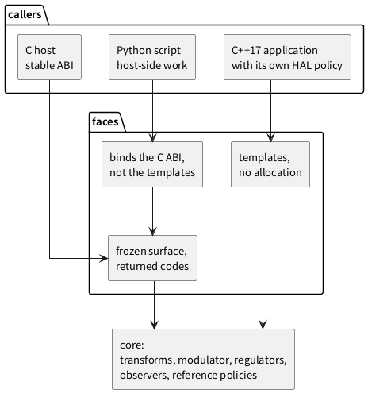
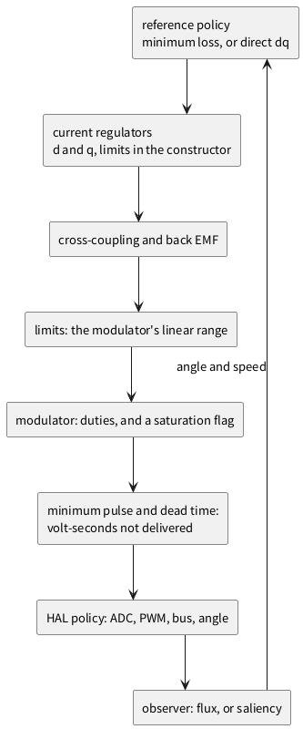
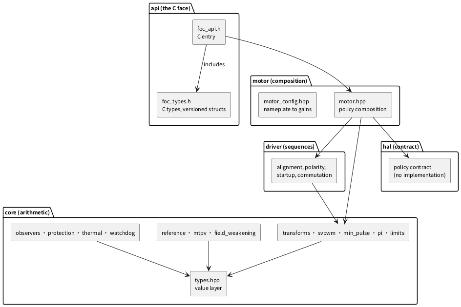
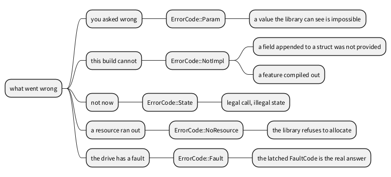
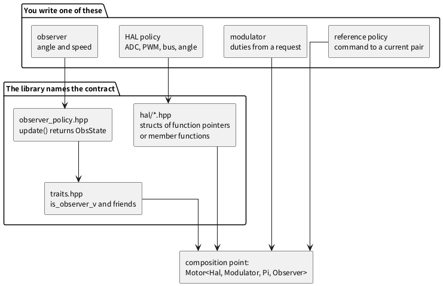
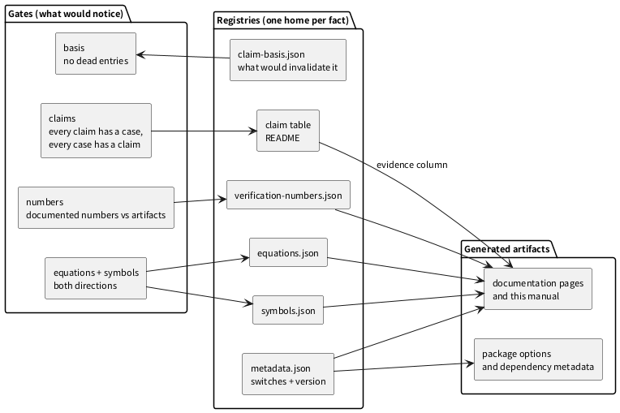

_`Architecture`
===============

This page answers the question the reference documentation does not: **why is the library
shaped this way**. It is written for three readers -- the architect deciding whether this
belongs in a product, the reviewer deciding whether its shape holds, and the integrator
deciding where they are expected to cut.

The position
------------

Most motor-control software is one of four things, and each is right for somebody. A vendor
SDK brings a working drive on one part family and the vendor's abstraction with it. A
model-based toolchain generates code from a block diagram. A research library lives where
iteration is cheap. A framework owns the application, including the loop and the memory.

The position this library takes is the space those leave: **a core that can be handed to a
reviewer, whose cost is bounded by construction, whose numerical behaviour is argued rather
than asserted, and which is the same code from C++, from C and from a script.**

That position is a set of refusals, and each is a decision rather than a preference:

- **no heap in the loop**, which forbids containers and buys a worst case that can be
  written down;
- **no exceptions and no RTTI**, which buys an error path whose cost is a returned value;
- **no virtual dispatch on the periodic path**, which buys inlining through the whole chain;
- **no defaults that could hide a fault**, which buys a boot that fails loudly instead of a
  protection that was never enabled.

What a breadth-first library optimises for, and what changes here
-----------------------------------------------------------------

The architecture chapter of a large library is a map of a breadth-first system: the module
graph, the data objects that flow through it, how to plug in a new algorithm, which backends
are interchangeable. Those libraries are judged on coverage and on being a substrate for other
people's work, so they are optimised for **extension volume**.

A hard-real-time core is optimised for the opposite: a small number of seams, each of them
compile-time, and a cost that does not depend on the input. The dimensions are the same and
the answers are inverted.

.. list-table:: The same dimensions, the opposite answers
   :header-rows: 1
   :widths: 16 37 47

   * - Dimension
     - A breadth-first library
     - This one, and why
   * - Extensibility
     - hundreds of algorithms behind one interface, discovered at run time
     - four policy seams, fixed at compile time, because a run-time lookup is a cost the
       loop cannot audit
   * - Object model
     - deep hierarchies, shared ownership, reference counting
     - value types and composition; ownership stays with the caller, so there is nothing to
       count and nothing to leak
   * - Data flow
     - images and meshes through a pipeline of stages
     - one request and three duties per period; the state is the controller's, not the
       library's
   * - Backends
     - interchangeable, selected by configuration
     - one HAL policy per build; the hardware is not a run-time detail
   * - Error model
     - exceptions or status trees, because failure is rare and deferred
     - a closed set of returned codes, because failure must be decided in the same period
   * - Binary compatibility
     - versioned libraries, plugins, symbol visibility
     - a frozen C surface with size-tagged structs and generation-checked handles
   * - Cost model
     - measured per operation, optimised per backend
     - bounded by construction: no allocation, no dispatch, no exception

Two consequences surprise readers arriving from a breadth-first library. There is **no plugin
architecture**, and that is not an omission: adding an observer is a template argument plus a
case, and the compiler is the registration mechanism. And the **C surface exists for the
opposite reason a C API usually exists** -- not to let other languages in, but to give the
core a boundary that cannot grow accidentally, since every declaration there is a promise
about the next decade.

Three faces, one core
---------------------

The core cannot be written in the language of any one consumer: it is value types and
functions over them, and each face is a thin adaptation.

   Each arrow points inward. No face knows about another, and Python reaches the core only
   through the C surface.

The dependency direction is not a style preference. If Python could reach the templates
directly, the C surface would stop being a constraint on it and the two surfaces would drift,
with the tests of one silently not covering the other.

The loop, composed rather than inherited
----------------------------------------

The periodic path is a composition of policies fixed at compile time: the HAL is a template
parameter, the modulator is a template parameter, the regulator is a template parameter, and
the composition is a type.

   One PWM period: the reference, the regulators, the limits, the modulator, the minimum-pulse
   stage, the HAL, and the observer closing the loop through the angle.

Two asymmetries in that picture are where this differs from a textbook cascade. The **limits
are inside the chain** rather than at its output, so a regulator knows the ceiling it is
working against rather than discovering it afterwards. And the **minimum-pulse and dead-time
stage sits between the modulator and the HAL**, because those losses happen between
arithmetic and copper and nothing downstream can infer them.

The layering, and what may depend on what
-----------------------------------------

   Header layers. The value layer is the floor: everything may depend on it and it depends on
   nothing but the standard library. The HAL appears as a box with no arrows out, because it
   is a policy the caller implements rather than a module the library calls.

Two rules hold the picture up. **A third-party header may not reach a public header**: the
cost was measured to be multiples of the entire include face, so the answer is no rather than
"only a little", and the dependency gate is what says so. And **the C face is a mirror, not a
dependency**: ``foc_types.h`` is written by hand against the value layer's semantics rather
than generated from it, because a generated mirror breaks whenever the generator does -- and
it breaks in the ABI.

The data model
--------------

Everything that flows through the library is a small value type whose name says what it is: a
phase triple, a stationary pair, a rotor-frame pair, a configuration struct, a result struct.
They are trivially copyable, they have no invariants a constructor must defend, and the
library never owns them.

Three properties follow. **No aliasing**: a function that takes a value cannot be affected by
another context mutating it, so "who else holds this" never arises in the loop. **No hidden
state**: a result struct carries what the caller needs to decide what happened -- a saturation
flag, a mask, a timestamp and a status -- so nobody has to ask the object what it meant.
**Units in the names**: the symbol registry generates the symbol table, and a quantity without
a registered unit fails the documentation's gates, which is a cheap way to make "milliseconds
where seconds were expected" a visible mistake.

The failure model
-----------------

Failure is a value with a small closed set of meanings.

   What can go wrong and which code carries it. The distinction that matters operationally is
   between "you asked wrong" and "this build cannot".

That distinction is not pedantry. Some fields of the host setup structure are appended over
time, and an absent one means the caller was compiled against an older header rather than that
the value is zero. A call that needs an absent field answers *not implemented*, because
otherwise "we never asked" reads like "nothing is wrong" -- and the caller's recovery differs:
one is fixed by passing the value, the other by rebuilding.

Two conventions complete the model. **Refusals happen before work**: a configuration that
cannot be run is rejected at construction or at the first call that needs it. And
**diagnostics saturate rather than wrap**: a loss counter that wraps to zero reports "nothing
lost" at the moment everything was lost.

The configuration model
-----------------------

Configuration is a struct passed at construction, readable but never partly written. That is
stronger than it looks: there is no moment at which a running drive has a mixture of old and
new settings, which is the failure mode of a setter-based interface in a system with a
periodic interrupt.

Values divide into two kinds, and the division is visible in the types. **Boot-time** values
-- pole pairs, dead time, switching period, current limits -- describe the hardware and are
fixed for the life of the object. **Run-time** values -- references, enables, mode -- are
commands and are functions rather than fields. Mixing the two is the most common silent
integration error after a wrong pole count, because a dead time copied onto a different bridge
behaves exactly like a machine whose resistance is wrong.

The refusal policy completes it: a value that is merely unhelpful is accepted, and a value
that is **inconsistent** is refused. An injection amplitude of zero is not "off"; it is a
request for an observer that cannot work.

The memory and concurrency models
---------------------------------

There is no allocation anywhere. Fixed-capacity rings, fixed-size observer state, configuration
by value. Tracing is switched by changing a **type**, not a flag: the disabled channel is an
empty type whose methods the optimiser deletes, so "off costs nothing" is structural and the
size of the motor does not change with tracing enabled.

There is one loop, one context and no locks. Every entry point is written for exactly one
caller, and the library does not pretend to be thread-safe by adding mutexes a real-time path
cannot afford to take. What it does instead is make the dangerous boundary explicit: the HAL
is called from inside the period, so an implementation that blocks has broken the loop's
premise -- the contract says so, and the porting checklist asks about it.

The extension model
-------------------

There are four seams, and they are one kind of seam: a template parameter whose required
interface is a handful of member functions, checked at compile time.

   You write one of the boxes on the left; the library names what it needs and checks it when
   the composition is instantiated.

Adding a capability is a compile-time act with three consequences. The cost of the new code is
visible in the call graph, because it is inlined where it is used rather than dispatched. A
configuration is a type, so two variants are two binaries rather than one binary with a flag --
cheap to reason about, expensive in code size for a large variant matrix. And a wrong
implementation fails to compile rather than failing at run time.

The seams are deliberately few. A fifth would be a commitment to a fifth kind of variation,
and this project would rather add one after seeing the variation twice.

The compatibility model
-----------------------

The C surface is frozen in the way that matters: existing declarations do not change meaning,
structures carry their own size so appending a field is compatible, and handles carry a
generation counter so a stale one is detected rather than dereferenced. The C++ surface is not
frozen the same way, and the asymmetry is deliberate: templates are recompiled, binaries are
not.

The practical rule is: depend on the C surface when the dependency must survive a rebuild you
do not control, and on the templates when you want the inlining.

Where the numbers live
----------------------

A fact has one home, and the artefacts that repeat it are generated.

   The registries, the artefacts generated from them, and the gates that would notice a
   disagreement. The claim table is a registry like the others: its evidence column makes a
   claim checkable and its basis column makes a change's blast radius computable.

This is architecture rather than bookkeeping because it decides what a reviewer can ask.
"Where does this number come from" has a file answer; "what would invalidate this claim" has a
file answer; "what prevents this from rotting" has a gate answer.

The costs, and who pays them
----------------------------

.. list-table:: Four decisions and their price
   :header-rows: 1
   :widths: 21 23 26 30

   * - Decision
     - Alternative rejected
     - What it would have bought
     - What it costs, and who pays
   * - Composition at compile time
     - a run-time interface per component
     - deciding a variant at run time, one binary for many products
     - a factory one level up in the product; the integrator pays
   * - No exceptions
     - throwing from deep inside a nested call
     - error paths that do not lengthen signatures
     - every call that can fail returns a value; the author pays
   * - No allocation
     - strings, containers, logging in place
     - convenience, and error messages built at the failure site
     - fault reporting is a code plus a counter; commissioning pays
   * - Refusals instead of defaults
     - a permissive configuration with sensible zeros
     - a boot that never argues
     - bring-up friction at least once per board; the integrator pays
   * - Frozen C surface
     - evolve the C API freely with the templates
     - fewer, simpler declarations
     - a size field in every struct crossing the boundary; the binding author pays

None of these is a defect to be fixed later. Each is the other side of a stated constraint,
and adopting the library is deciding whether those costs are cheaper than the alternative's.

How the shape was arrived at
----------------------------

History. This section is a record rather than a specification, and the word above is what the
documentation's voice gate looks for before it lets a paragraph talk about the past.

The shape converged rather than being designed in one sitting, and the sequence is visible in
the repository.

**Refusals came first, and they came from failures.** Each of the four prohibitions began as a
defect in something built on top: a loop whose period occasionally overran, an observer that
silently did nothing, a configuration that was accepted and produced a drive that merely looked
configured. The rule that followed is mechanical -- when a failure is found, the fix is written
as a refusal that fails loudly, because a default that keeps working a little is how the same
defect returns twice.

**The registries came from documentation drift.** Documentation that carried numbers in prose
stopped being true. The response was not to check harder but to give each fact a file and
generate everything that repeats it, then add a gate that compares the documented copy with
the artefact -- which is why the site and the manual both draw their numbers from registries.

**The evidence model came from a claim nothing could contradict.** A statement was found that
had passed every check because no check was about it. The claim table, the case pointer in both
directions, and the basis graph all date from that discovery, and the correction is recorded
publicly in :doc:`foundation-log`.

**The C face came from a versioning problem, not from a portability wish.** The binary boundary
exists because consumers were recompiling the templates and the semantics were drifting between
them. Freezing the C surface forced the semantics into declarations, and the other bindings then
had something stable to bind to.

**The infrastructure layer is byte-pinned on purpose.** The build system and the formatting and
linting configuration are not edited by hand; they are owned outside this library and checked
byte for byte, because a project that lets its own build files drift cannot make claims about
anybody else's builds.

The practical lesson is the one worth carrying: each decision above is a response to something
that had already gone wrong, each is cheap to describe and expensive to retrofit, and the shape
is what survived.

How to review the architecture
------------------------------

- Does the periodic path allocate, throw, or dispatch virtually? The build disables two of the
  three; the third is checked by reading the composition, which is a type.
- Can a consumer reach the core without going through a declared face? The layering picture is
  the claim; the include face is the check.
- Is every fact in one place, and is disagreement detectable? The registries and the gates
  answer it, and the answer is checkable by running them.
- What happens when a configuration is wrong? It is refused, with a code that separates "you
  asked wrong" from "this build cannot".
- How does a new capability enter? Through one of four seams, at compile time, with its
  interface checked by the compiler and its behaviour checked by a case.
- What does the architecture refuse to do, and is that written down? This page and
  :doc:`boundaries`, in that order.
