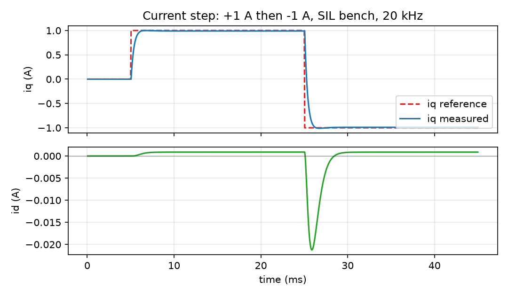

_`Current step`
===============

The q-axis reference jumps 0 → +1 A → −1 A while the motor stays at standstill. This is the
sharpest test of the current loop: the integrator sees a full step twice, in opposite directions.

   iq follows the reference within about 1 ms; id is held near zero, with only a coupling blip at
   the reversal

.. csv-table:: measured on the +1 A half step
   :header-rows: 1
   :file: metrics_current_step.csv

What to look for: no overshoot, no integrator wind-up at the reversal (the second step settles as
cleanly as the first), and a d-axis disturbance that stays two orders of magnitude below the
q-axis setpoint.
