_`Measured responses`
=====================

Every figure below is produced by running this library — no mock-up, no hand-drawn curve. The
pipeline is:

#. :code:`docs/demos/sil_export.cpp` drives the SIL bench through one scenario and writes a trace
   and a metrics CSV;
#. :code:`docs/demos/make_figures.py` compiles it against the repository sources, runs it, and
   plots the result;
#. :code:`python docs/build.py` copies the figures into the site.

.. code-block:: bash

   source ~/venv/build/bin/activate        # matplotlib + numpy
   python3 docs/demos/make_figures.py      # regenerate figures and tables

To compile one example by hand instead: every example links against the whole of ``src/``
minus ``version``, which the Conan recipe wraps in ``extern "C"`` and the raw headers do not.

.. code-block:: bash

   g++ -std=c++17 -O2 -Iinclude -Itest_package/test/unit \
       docs/doxygen/dox/demos/torque-reference.cxx \
       $(find src -name '*.cpp' -o -name '*.c' | grep -v '/version\.') \
       -o /tmp/torque-reference

Swap the stem for the example you want; each slice page below links to the one it uses.

The scenarios mirror the SIL acceptance suite, so what you see here is the same closed
loop the test suite asserts on.

This page is the **picture index** of the site: one figure per task, in the order a machine
meets them. Each figure is followed by what to look for and by the page that explains how to
produce it. The numbers stay where they are measured — the three SIL scenarios keep their own
metrics tables below, everything else points at the claim table in the project ``README.md``
rather than copying a value into prose.

Closed loop on the SIL plant
----------------------------

Three scenarios that need a closed loop: a current step, a speed step, and a sine. The C API —
and therefore the Python module — runs on the stub HAL, whose current feedback is a fixed
script, so these three come from the **C++** path with the SIL plant.

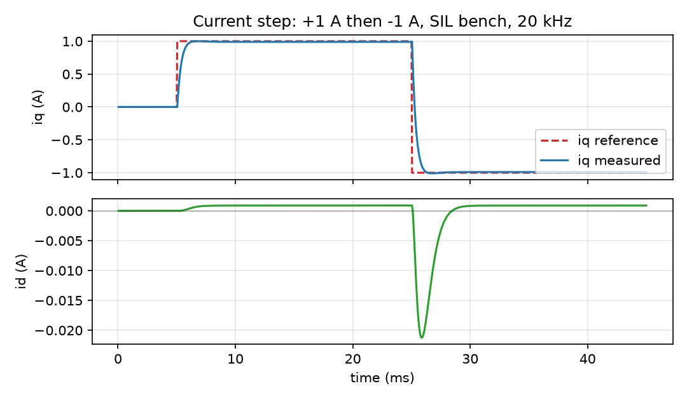

   q-axis reference jumps 0 → +1 A → −1 A at standstill; iq follows it twice, the second time
   in the opposite direction

.. csv-table:: measured on the +1 A half step
   :header-rows: 1
   :file: metrics_current_step.csv

What to look for: no overshoot, no integrator wind-up at the reversal (the second step settles
as cleanly as the first), and a d-axis disturbance two orders of magnitude below the q-axis
setpoint. Explained in :doc:`../guides/torque-reference`.

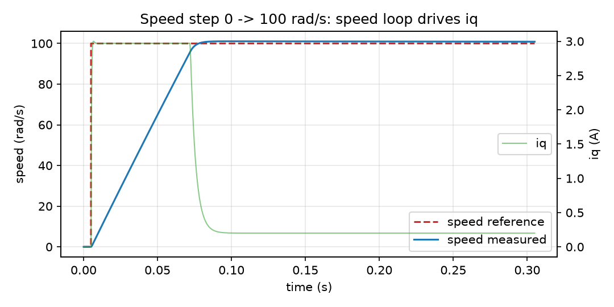

   speed reference steps to 100 rad/s while the current loop stays at 20 kHz: iq saturates
   during the ramp and collapses to the friction-compensating value once the speed settles

.. csv-table:: measured on the step
   :header-rows: 1
   :file: metrics_speed_step.csv

What to look for: iq hits its limit during the ramp — the loop is doing the right thing, not
fighting itself — a small overshoot, and a steady-state error inside one percent. The outer
loop this trace runs is the one tuned by :doc:`../sop`.

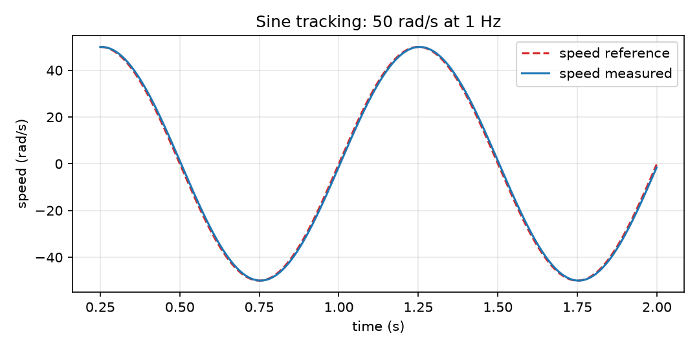

   measured speed against a 1 Hz sine reference, first 0.25 s of transient trimmed off

.. csv-table:: measured over two cycles
   :header-rows: 1
   :file: metrics_sine_tracking.csv

What to look for: the peak-to-peak swing stays at the reference amplitude (no collapse) and the
worst error stays a few percent. A step test cannot see phase lag and amplitude collapse; a
sine can. Explained in :doc:`../sop`.

One response per task
---------------------

The same figure step, applied to each task slice's own example — no plant, no closed loop,
just the quantity that task is about:

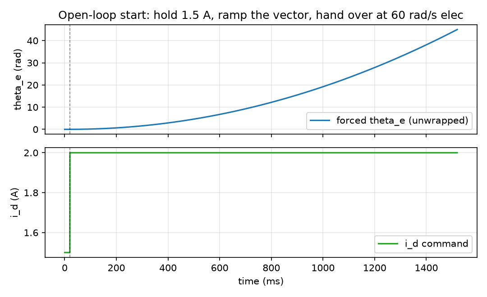

   the forced angle, unwrapped, and the current the start-up recipe asks for: a flat hold, then
   the pull

:doc:`../guides/startup-sensorless` — what the curve cannot show is whether the rotor followed.

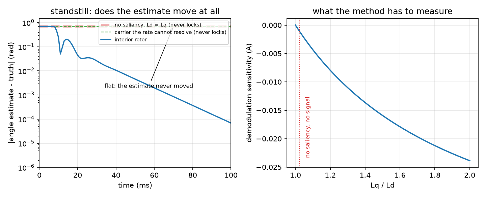

   left: angle error against time for three saliency ratios, on a log axis because the decay is
   over inside the first division; right: the library's own sensitivity function, zero at a
   saliency ratio of one

:doc:`../guides/low-speed-injection` — the right panel is the reason a surface-mount machine
gets no benefit from injection.

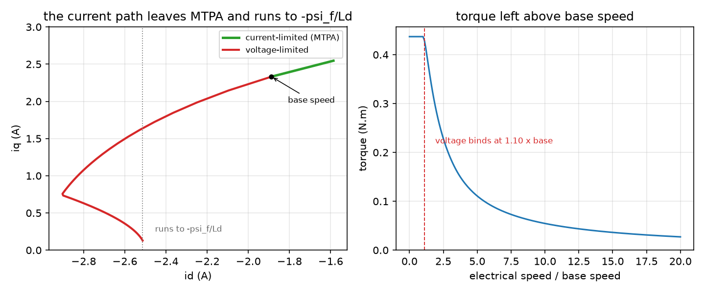

   left: the current path from the MTPA point at the current ceiling, past the base-speed
   marker, along the voltage ellipse towards the characteristic current; right: the torque that
   is left as the speed rises

:doc:`../guides/high-speed-field-weakening` — read the left panel together with
:doc:`../guides/modulation-limits`: the ellipse is where modulation ends.

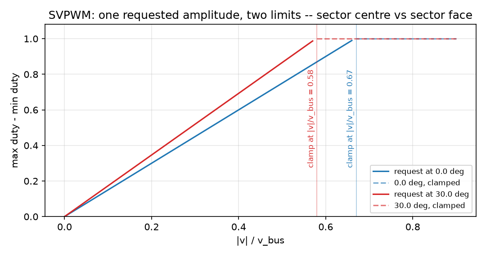

   the same amplitude sweep at 0 and at 30 electrical degrees: both grow linearly with the
   request, and they clamp at two different amplitudes

:doc:`../guides/modulation-limits` — the gap between the two clamp points is the overmodulation
region, and it is where six-step lives.

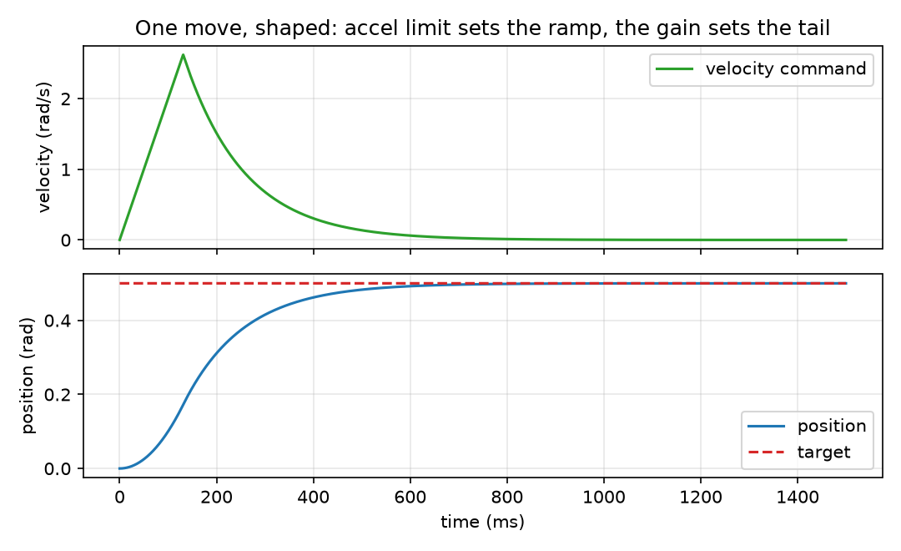

   one move shaped by an acceleration limit: the velocity command ramps up at the ceiling, then
   decays as the error shrinks, and the position converges without overshoot

:doc:`../guides/positioning` — the profile is the reference, so the tail of the curve is the
plant's, not the loop's.

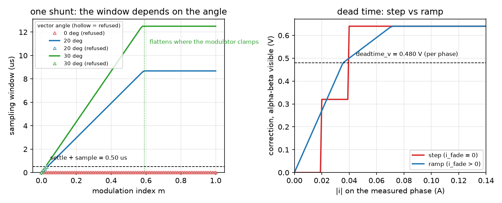

   left: the sampling window one shunt leaves, against the modulation index, at three vector
   angles — hollow markers are the samples the library refused; right: the dead-time correction
   the library commands, read in the alpha-beta frame, for a step and a ramp

:doc:`../guides/current-sampling` — the refusals matter more than the window: a refused sample
is the library saying it does not know the current.

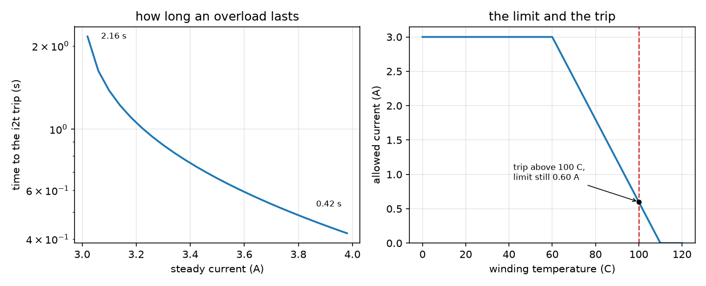

   left: how long an overload lasts below the hard trip — a duration that runs away as the
   current approaches the rating; right: the continuous limit against temperature, with the trip
   threshold drawn on top of it

:doc:`../guides/protection-and-derating` — the trip line is read from its own constant, so the
two panels cannot disagree.

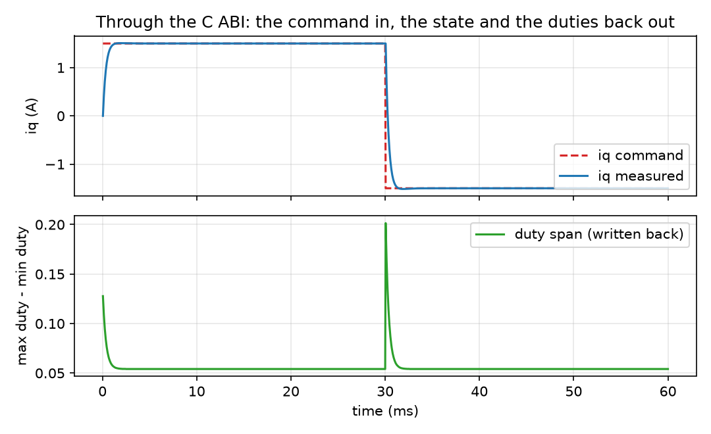

   a torque command through the C ABI: the measured current follows the command, and the duty
   span written back through the callback moves at each step

:doc:`../guides/c-and-cpp-callers` — the same experiment runs through the C++ door, and the page
reports the difference between the two doors rather than the curve.

Where the numbers live
----------------------

No figure on this page states a measured value in its caption. A value that matters is either a
row of one of the three metrics tables above (written by the same run that drew the curve) or a
claim row in the project ``README.md``, whose evidence is a test case. :doc:`../usage` collects
those claim rows per face; :doc:`../capabilities` says what each one owes.
