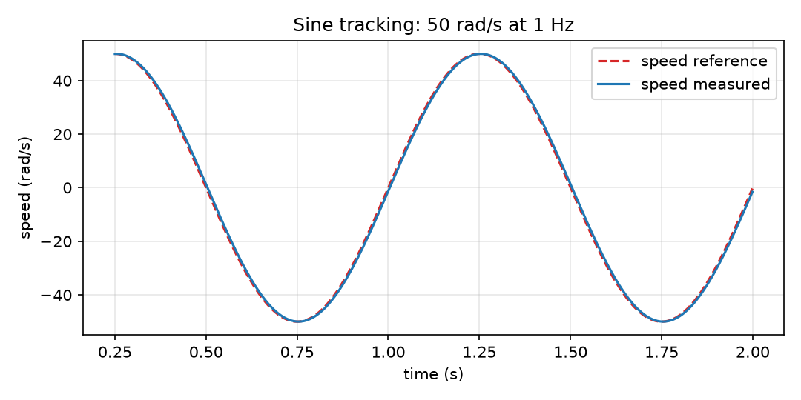

_`Sine tracking`
================

The speed reference is a 1 Hz sine of 50 rad/s amplitude — the scenario that exposes phase lag and
amplitude collapse, which a step test cannot see.

   Measured speed against the reference (the first 0.25 s transient is trimmed off)

.. csv-table:: measured over two cycles
   :header-rows: 1
   :file: metrics_sine_tracking.csv

What to look for: the peak-to-peak swing stays at the reference amplitude (no collapse) and the
worst error stays a few percent — the phase lag is visible but small, which is what a 250 rad/s
speed loop buys you at 1 Hz.
