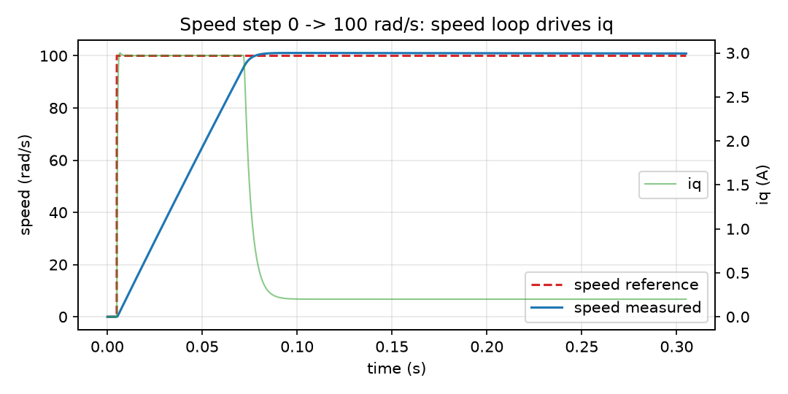

_`Speed step`
=============

The speed reference steps 0 → 100 rad/s while the current loop stays at 20 kHz. The outer loop
saturates iq, the plant accelerates, and the loop pulls back before the reference is reached — the
classic cascade behaviour.

   Speed reaches the setpoint in about 70 ms; iq saturates during the ramp and collapses to the
   friction-compensating value once the speed settles

.. csv-table:: measured on the step
   :header-rows: 1
   :file: metrics_speed_step.csv

What to look for: iq hits its limit during the ramp (the loop is doing the right thing, not
fighting itself), a small overshoot, and a steady-state error well inside one percent.
