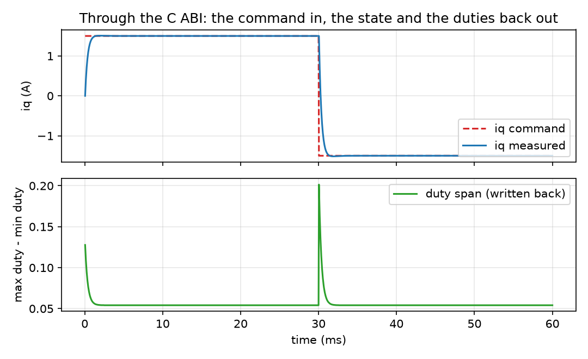

_`Consuming the library from outside C++`
==========================================

The task: the control law is chosen, the board is built, and the application is
not C++. Get the loop running from C, from Python, or from a simulation master
without reimplementing any of the previous slices.

What you need
-------------

- ``foc/api/foc_api.h`` and ``foc/api/foc_types.h`` -- the frozen C11 surface.
  Opaque handles, no C++ in the include graph, every return code checkable.
- ``foc_hal_callbacks_t`` -- the host's side of the contract: five required
  function pointers and a `user` pointer handed back unchanged.
- ``foc/comm/frame.hpp`` -- the wire format, for anything that talks to this
  library over a link rather than through a function call.
- ``foc/comm/register_map.hpp`` -- the register table, for hosts that speak
  addresses rather than structs.
- ``foc/comm/encoder_stream.hpp`` -- serial encoder framing (BiSS-C and its
  CRC-6), for the position source.
- ``api/python_bindings.cpp`` and ``api/fmu/`` -- the two other delivery shapes,
  both thin: the Python module binds the C ABI, and the FMU is the same control
  loop behind FMI.

A minimal program
-----------------

``docs/doxygen/dox/demos/c-and-cpp-callers.cxx`` is the whole sequence:

.. code-block:: bash

   g++ -std=c++17 -fno-exceptions -fno-rtti -Wall -Wextra -Werror -Iinclude \
       docs/doxygen/dox/demos/c-and-cpp-callers.cxx src/api/foc_api.c \
       src/api/bridge.cpp src/core/*.cpp src/motor/*.cpp src/comm/*.cpp \
       src/driver/*.cpp src/core/observer/*.cpp -o /tmp/c-and-cpp-callers

Two details in it are the ones that cost integrators a day:

- **`foc_motor_create_host()` answers `FOC_ERR_NOT_IMPL`, not `FOC_ERR_PARAM`,
  when `read_drive_fault` is missing.** That field is appended to the callback
  struct, so a caller built against an older header passes NULL through no fault
  of its own. The two answers mean different things: "this host cannot tell you
  about faults" is not "you passed a bad argument", and the library refuses to
  let the first read like the second.
- **`struct_size` is what makes the appended fields visible at all.** The library
  reads only what the caller's `struct_size` covers, which is why an older caller
  keeps working and a newer field is simply not read rather than read out of
  somebody's stack.

Where the numbers come from
---------------------------

- **The nameplate** is passed as plain data, in struct order. Nothing is derived
  from it that the caller does not state.
- **Zero means the library default** for every field of `foc_motor_setup_t`, and
  `foc_motor_get_setup()` reports what was actually applied -- so a caller never
  has to guess which defaults it got.
- **The callbacks are the board**: current sense scaling, dead time and the DC
  link voltage are the integrator's measurements, not the library's. `MinPulse`
  and :doc:`modulation-limits` are where the numbers those measurements
  imply are used.

How it goes wrong
-----------------

1. **A dropped return code.** Every `foc_*` function is marked
   `FOC_WARN_UNUSED`, so ignoring one is a build failure -- and `(void)` does
   **not** silence it on GCC. Binding first (`foc_err_t e = ...; (void)e;`) is the
   escape, and it is deliberately the more typing.
2. **A leaked handle.** The pool is static and small; a handle owns a slot until
   `foc_motor_destroy()`. A program that creates motors in a loop and forgets one
   path eventually gets `FOC_ERR_NO_RESOURCE` from a place that looks unrelated.
3. **A stale handle after destroy.** Handles carry a generation counter, so a
   stale one answers `FOC_ERR_PARAM` rather than reaching a freed slot -- but it
   does answer an error, and code that treats "not OK" as "retry" will spin.
4. **A hand-rolled wire format.** `frame` exists because a CRC and a length field
   are two places to get it wrong, and its parameter set is one of the claim rows.

Evidence
--------

The C ABI's own claim rows cover this slice (``foc/api/foc_api.h`` and
``foc/api/foc_types.h``), together with the three wire headers. The level this
page may state is the minimum of those rows, read from the claim table in the
project ``README.md``; the C surface is graded lower than the C++ one on purpose,
because its anchors are closed-form identifications rather than the full model.

Figure
------

   a torque command through the C ABI: the measured current follows the command,
   and the duty span written back through the callback moves at each step

The figure is produced by ``docs/demos/make_figures.py`` from this page's own
example. Its host is a **stand-in** -- Ohm's law across the winding plus the
winding's `L/R` -- so the curve shows that the loop regulates and that the values
cross the ABI intact. It is not a control result; a real host feeds ADC samples,
which is what the SIL demos do.
