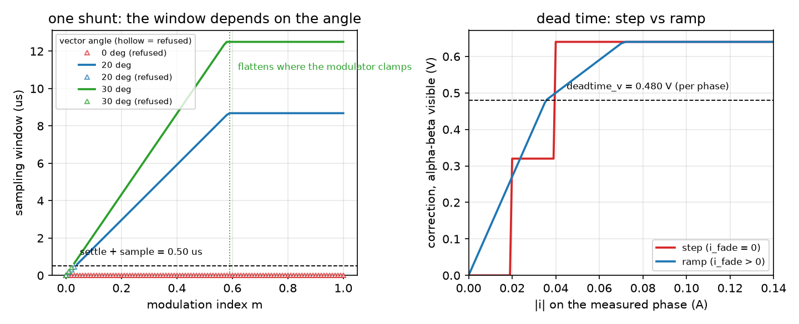

_`Sampling and the power stage`
===============================

The task: decide whether the current can be measured at all this switching
period, understand what the bridge does to the voltage it was asked for, and get
one diagnosis out of a bench session instead of a list of failures.

What you need
-------------

- ``foc/core/single_shunt.hpp`` -- the sampling windows one DC-link shunt leaves
  you, and the three-valued verdict that comes with them.
- ``foc/core/deadtime.hpp`` -- the phase-domain dead-time correction, its two
  shapes, and the estimator that identifies the fade width.
- ``foc/core/board_check.hpp`` -- the measurands a bench session produces, and
  the mapping from a failure pattern to the one thing most likely wrong.
- ``foc/core/trace.hpp`` -- a fixed-capacity ring of per-period samples. It
  records the currents and voltages the loop *believed*, one record per control
  period with the platform clock next to them -- which is also why it cannot
  answer a sampling-instant question on its own.

A minimal program
-----------------

``docs/doxygen/dox/demos/current-sampling.cxx`` sweeps the modulation index at
three angles against the shunt verdict, reads the dead-time correction in two
configurations, and runs the board check twice on the same measurements. The same
file produces this slice's figure.

.. code-block:: bash

   g++ -std=c++17 -fno-exceptions -fno-rtti -Wall -Wextra -Werror -Iinclude \
       docs/doxygen/dox/demos/current-sampling.cxx src/core/svpwm.cpp \
       src/core/single_shunt.cpp -o /tmp/current-sampling

Where the numbers come from
---------------------------

- **The settling time and the sampling time** are your ADC's and your gate
  driver's, not the library's. Together they are the number every window is
  compared with, so they decide whether a topology is usable at your switching
  frequency at all.
- **The switching period** turns duties into seconds, and it is also the
  denominator of the dead-time voltage: the loss is `t_dead / T_pwm` of the bus,
  so the same nanoseconds cost twice as much at half the frequency.
- **The fade width** is the one number nobody can compute from a nameplate.
  `predicted_ripple_a()` is an upper bound that is wrong by an order of
  magnitude, and `DeadTimeFadeEstimator` is what replaces it -- with a result
  whose own header advises against using it.
- **The board limits** are tolerances, kept separate from the measurements so a
  saved session can be re-judged without being re-run.

How it goes wrong
-----------------

1. **The window read as a function of amplitude only.** It is a function of the
   vector's angle as well. At a sector boundary two phases carry the same duty,
   one of the two active intervals is exactly zero, and no modulation index makes
   it measurable -- the sweep in the figure's left panel sits on the axis for
   every request. A design that validated its sampling at one operating point
   has validated one operating point.
2. **A correction measured in the wrong frame.** The library adds its correction
   per phase, then projects back to alpha-beta to reach the modulator, and that
   projection drops the part common to all three phases -- which a floating star
   point cannot see either. Read the same correction in one phase's duty and the
   modulator's own common-mode shift takes another bite. The example prints the
   same number three ways; a measurement note that does not say which frame it
   used cannot be reproduced.
3. **"Measurable" treated as a boolean.** The verdict has three values, and the
   two failures are not the same failure: a narrow window can be waited for, an
   empty one means the pattern itself gives nothing to sample, so the answer is a
   different sampling instant rather than a longer one.
4. **Trusting an identified parameter because it is identifiable.** The fade
   width can be identified and it still loses to the plain step; the header
   records both the comparison and the reason. Identifiability says the number
   exists, not that the model it belongs to is the right shape.
5. **A report that lists failures instead of naming a cause.** Two inverted
   phases make the ripple comparison meaningless, so a session can fail three
   items and still have one thing to fix. The example runs the check before and
   after fixing it, and the second session names a different item -- which is the
   only way to know the first diagnosis was right.

Evidence
--------

Four claim rows cover this slice -- ``foc/core/single_shunt.hpp``,
``foc/core/deadtime.hpp``, ``foc/core/trace.hpp`` and
``foc/core/board_check.hpp`` -- and the level this page may state is the minimum
of those four. The numbers behind the window sizes, the identified fade width
and the diagnosis mapping live in those rows and in their test files, not on
this page.

Figure
------

   left: the sampling window one shunt leaves, against the modulation index, at
   three vector angles -- hollow markers are the samples the library refused;
   right: the dead-time correction the library commands, read in the alpha-beta
   frame, for the step and the ramp

The figure is produced by ``docs/demos/make_figures.py`` from this page's own
example. The "settle + sample" line and the per-phase ``deadtime_v`` line both
come out of the CSV's ``limit`` column, so they are the configuration the run
used rather than constants typed into the plot. What the figure does not show is
the hardware the numbers describe: no ADC samples here, no ringing, and the flat
top of each window curve is the modulator clamping rather than anything the shunt
does. Whether the ramp beats the step on a real bridge is a switching-plant
measurement, and it lives in the claim row.
