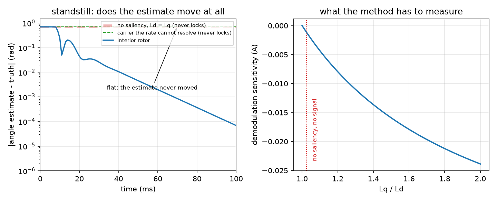

_`Zero and low speed`
=====================

The task: produce torque with no back EMF to observe, and find out before the
commissioning session whether this machine can be observed at standstill at all.

What you need
-------------

- ``foc/core/observer/hfi_observer.hpp`` -- saliency tracking by high-frequency
  injection: the carrier, the demodulator, the PLL, and the two refusals.
- ``foc/core/observer/dual_inductance_observer.hpp`` -- the same flux integrator
  with the angle recovered from two inductances instead of one. It needs no
  injection, and on a machine with equal inductances it degenerates to the
  single-inductance answer -- so it is not a way around the first failure mode
  below, it is a way to stop paying the bias that a single inductance brings.
- ``foc/core/observer/blended_observer.hpp`` -- the hand-over between the two as
  speed rises, so the slice does not end at the point where the low-speed method
  stops working.

A minimal program
-----------------

``docs/doxygen/dox/demos/low-speed-injection.cxx`` holds a salient machine at
standstill, drives it with the observer's own injection, and runs the loop three
times: a surface-mount rotor, an interior rotor, and an interior rotor observed
by a controller that cannot resolve the carrier. The same file produces this
slice's figure.

.. literalinclude:: ../../../../docs/doxygen/dox/demos/low-speed-injection.cxx
   :language: cpp
   :linenos:

Where the numbers come from
---------------------------

- **The demodulation sensitivity** is not a tuning knob: ``predicted_gain_a()``
  computes it from the injection amplitude, the carrier frequency and the
  machine's two inductances. Taking it from the machine is what turns "HFI does
  not work here" into a number that is zero for a reason.
- **The carrier frequency** is bounded above by the control rate -- the
  library's ``max_inject_hz()`` is the bound, and it is a ratio of samples per
  carrier rather than a frequency, so it moves with your ISR period.
- **The injection amplitude** is a trade with a formula: a carrier that another
  observer cannot distinguish from back EMF leaves a flux residue of
  ``inject_v / (2*pi*inject_hz)`` behind, because an integrator has no reset.
- **The current high-pass** is set above the highest electrical frequency HFI is
  meant to work at and well below the carrier, because the demodulator multiplies
  by the carrier and anything DC in the current leaks straight through it.

How it goes wrong
-----------------

1. **A surface-mount rotor attempted anyway.** The sensitivity is exactly zero,
   so there is nothing to demodulate; the configuration is refused rather than
   run. The figure's left panel is what "attempted anyway" looks like: the
   estimate never moves, and it never moves for the whole window rather than
   converging late.
2. **The error output read as the angle error.** ``error()`` is the demodulator's residual, and
   it is zero both when the lock is perfect and when there is no signal at all --
   the two cases a start-up most needs to tell apart. ``locked()`` is the answer;
   the example prints both next to the true angle error so the difference is
   visible rather than described.
3. **A carrier the control rate cannot resolve.** Past the boundary the amplitude
   collapses, the lock drops out, the angle freezes and the speed reads zero: a
   loop closing on that runs away with nothing reported as a fault. ``update()``
   refuses the configuration instead, which is why the example's third run
   reports a status rather than a wrong answer.
4. **A load step at standstill.** The dc content it puts into the current reaches
   the demodulator and becomes a standing bias in the error signal -- enough, at
   the wrong amplitude, to push a start-up across the half-turn boundary and lock
   the estimate to the mirror image of the rotor.
5. **A second observer left running alongside.** A back-EMF flux integrator cannot
   tell the carrier from real back EMF, and it has no reset: whatever the carrier
   deposits stays. The residue is computable from the carrier alone, so the
   amplitude is chosen against it before the run, not after.

Evidence
--------

Two claim rows cover this slice -- ``foc/core/observer/hfi_observer.hpp`` and
``foc/core/observer/dual_inductance_observer.hpp`` -- and the level this page may
state is the minimum of those two. Every measured number this page would
otherwise want to quote -- the angle bias the residue leaves, the carrier ratio
at which the lock fails, the bias a load step injects, the speed a runaway loop
settles at -- lives in the header's own measured notes and in those claim rows.

Figure
------

   left: the angle error against time for the three runs, on a log axis because
   the decay is over inside the first division; right: the library's own
   sensitivity function, zero at a saliency ratio of one

Both panels come from this page's example, and the right one is the library's
function rather than a fitted curve. What the figure does not show is the
hardware: the plant is two ideal axes with no noise, no saturation and no
cross-coupling, so the decay it shows is the observer's own settling and not a
prediction for a real machine. The costs that decide whether HFI is usable on
*your* machine -- angle bias, injected current, and what the carrier does to the
observer running beside it -- are the header's measured notes, and they are not
visible here.
