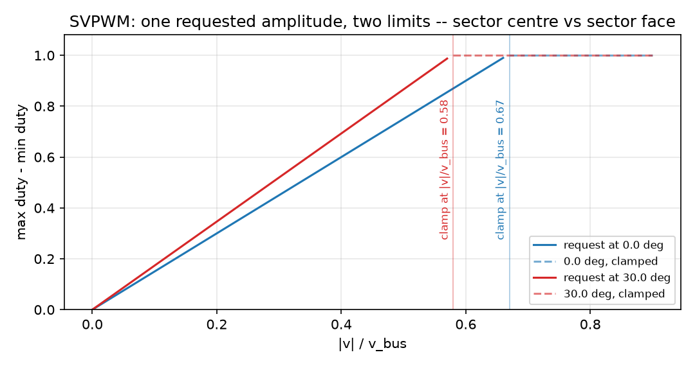

_`High speed and modulation`
============================

The task: turn the current loop's voltage request into three duties, know how much
voltage the bridge can actually deliver, and stop lying about what it delivered
when the pulses get short.

What you need
-------------

- ``foc/core/svpwm.hpp`` -- the space-vector modulator. One request in, three
  duties and a `saturated` flag out.
- ``foc/core/min_pulse.hpp`` -- what a real gate driver does to a pulse it cannot
  transmit, and the volt-seconds that costs.
- ``foc/core/six_step.hpp`` -- the block-commutation alternative, from a hall code
  with a rate limit on the table.

A minimal program
-----------------

``docs/doxygen/dox/demos/modulation-limits.cxx`` sweeps a requested amplitude at
two electrical angles, shapes a narrow pulse, and walks the six-step table twice.
The same file produces this slice's figure.

.. code-block:: bash

   g++ -std=c++17 -fno-exceptions -fno-rtti -Wall -Wextra -Werror -Iinclude \
       docs/doxygen/dox/demos/modulation-limits.cxx src/core/svpwm.cpp \
       src/core/min_pulse.cpp -o /tmp/modulation-limits

Where the numbers come from
---------------------------

- **The DC link voltage** sets everything. The modulator divides by it, so a
  sagging bus is a scaling error in every duty -- and the modulator answers
  `Param` with 50 % duties rather than producing NaNs when the bus is not
  positive.
- **The switching period** and the driver's **minimum pulse** come from the gate
  driver's datasheet, not from the controller. They are the two numbers that make
  "commanded voltage" and "delivered voltage" differ at low duty.
- **The dead time** belongs to the same datasheet and is the reason the
  modulator's input struct carries the measured currents at all: a dead-time
  term has the sign of the phase current, so a modulator that cannot see the
  current cannot compensate it.

How it goes wrong
-----------------

1. **One radius assumed for the whole rotation.** The reachable set is a
   hexagon. A request that fits at a sector centre does not fit at a sector face,
   so an amplitude chosen from the best case clips once per revolution -- and the
   clipped region arrives as a sixth-order torque ripple rather than as a fault.
2. **The clamp attributed to the controller.** When the modulator clamps, the
   current loop keeps integrating against a voltage it did not get. Anti-windup
   belongs where the request is actually reduced, which is inside the modulator's
   caller, not in the PI's own limit.
3. **Short pulses ignored.** Below the driver's minimum pulse a phase either
   fires for the full period or not at all; the average voltage the loop believes
   it applied is then simply wrong. `MinPulse` reports the difference per phase,
   signed, so a caller can compensate or at least know.
4. **An unrate-limited six-step table.** A single false hall edge moves the vector
   120 electrical degrees. `max_step_sectors` turns that into a refused step, and
   the rejections are counted where a telemetry channel can see them.

Evidence
--------

Three claim rows cover this slice -- ``foc/core/svpwm.hpp``,
``foc/core/min_pulse.hpp`` and ``foc/core/six_step.hpp`` -- and the level this
page may state is the minimum of those three. The numbers behind the two clamp
amplitudes live in those rows and in ``test_svpwm.cpp``, not on this page.

Figure
------

   the same amplitude sweep at 0 and at 30 electrical degrees: both grow linearly
   with the request, and they clamp at two different amplitudes

The figure is produced by ``docs/demos/make_figures.py`` from this page's own
example, and the clamp points are read from the run rather than printed from a
constant. What it does not show is the overmodulated fundamental: past the clamp
the modulator projects the request onto the hexagon, and what that does to the
*output* voltage needs a spectrum, which is what the claim row's cases measure.
