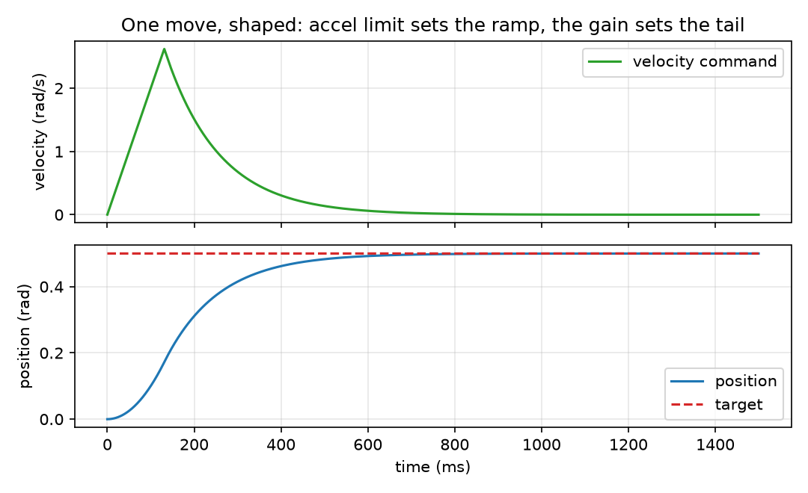

_`Positioning an axis`
======================

The task: move a joint to a position, inside a window it must never leave, fast
enough to be useful and gently enough not to excite the mechanics.

What you need
-------------

- ``foc/core/soft_limit.hpp`` -- admit or refuse a target. Refusing is the whole
  point: a limit that clamps instead hands the loop a position it was never
  asked for.
- ``foc/core/motion_profile.hpp`` -- shape a velocity command for the remaining
  error, under a velocity and an acceleration ceiling.
- ``foc/core/position.hpp`` -- the P law that turns a position error into a
  velocity or torque command.
- ``foc/core/position_reference.hpp`` -- unwraps the encoder and defines the
  origin; the first sample is the origin, which is why an axis without homing has
  an arbitrary one.
- ``foc/core/homing.hpp`` -- finds a real origin, so the numbers mean something
  after a power cycle.
- ``foc/core/gear_ratio.hpp`` -- one master angle in, a slave target and a slave
  velocity reference out.

A minimal program
-----------------

``docs/doxygen/dox/demos/positioning.cxx`` shows the two refusals, one
gear sample and one shaped move. The same file produces this slice's figure.

.. literalinclude:: ../../../../docs/doxygen/dox/demos/positioning.cxx
   :language: cpp
   :linenos:

The output to read first is the refusal: a target of ``1.5`` rad against a window
of ``[-1.0, 1.0]`` comes back as ``Param`` **and** as the previous target. A
caller that ignores the status goes on commanding the old position, and the axis
holding still looks exactly like an axis that arrived.

Where the numbers come from
---------------------------

- **The window** comes from the mechanics, not from the controller: where the
  axis physically may go. The walls are inclusive, so "move to the limit" is a
  command the limit can accept.
- **The acceleration ceiling** is what the mechanics and the current limit allow.
  **The velocity ceiling** is usually the same number times a time constant; it
  exists so a large error cannot ask for a speed the loop cannot stop from.
- **The shaping gain** has the dimension of a bandwidth (velocity per radian of
  error, 1/s), and it is the one number here that a user tunes. It is not the
  same knob as the position loop's gain: the profile shapes the command, the loop
  follows it.
- **The gear ratio and offset** come from the mechanics; the offset is the slave
  position at master zero, so it is a measurement, not a preference.

How it goes wrong
-----------------

1. **The refusal is ignored.** ``Param`` plus the previous target is a safe
   answer only if the caller reads the status; otherwise the axis parks and the
   application believes it is moving. Check the status on every call, not the
   target value.
2. **A gear without the velocity reference.** A position loop told only where to
   be lags a moving target by ``v * kd / kp``; on a geared pair that lag is a
   synchronisation error that no gain increase fixes without also raising the
   noise. Feed the slave velocity forward.
3. **An origin nobody defined.** ``position_reference`` defines the origin from
   the first sample, so an axis that never homed has a legal but arbitrary zero.
   Everything downstream -- soft limits included -- is then measured from the
   wrong place.
4. **Shaping treated as the loop.** The profile limits how fast the *command*
   moves; it says nothing about the axis. A profile tuned to the acceleration
   limit with a loop that cannot track it produces a shaped command and an
   unshaped motion.

Evidence
--------

Six claim rows cover this slice -- ``soft_limit``, ``motion_profile``,
``position``, ``position_reference``, ``homing`` and ``gear_ratio`` -- and the
level this page may state is the minimum of those six. The levels themselves are
read from the claim table in the project ``README.md``.

Figure
------

   one move shaped by an acceleration limit: the velocity command ramps up at the
   ceiling, then decays as the error shrinks, and the position converges to the
   target without overshoot

The figure is produced by ``docs/demos/make_figures.py`` from this page's own
example. The axis behind it is an integrator, so the curve shows the **shape** of
the command and the settling of a first-order approach -- not the dynamics of a
motor, which the SIL demos carry.
