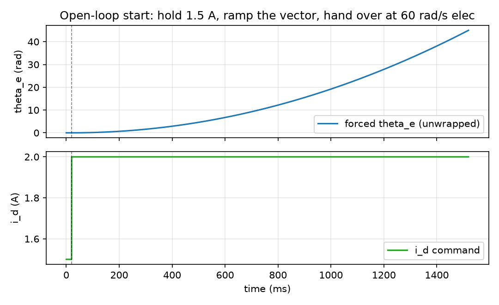

_`Bringing a sensorless machine up`
===================================

The task: the axis has no position sensor and no idea where the rotor is. Get it
spinning anyway, to a speed at which the observer can take over, and hand over
cleanly.

What you need
-------------

- ``foc/core/startup.hpp`` -- the sequence: hold the rotor at a known angle, drag
  the forced vector up with a known acceleration, stop at a hand-over speed.
- ``foc/core/alignment.hpp`` -- the same idea without the pull: hold and stop.
  Right when the angle is measured after the fact rather than inferred.
- ``foc/core/observer/blended_observer.hpp`` -- what takes over at the end, and
  why the hand-over happens at a *speed* rather than at a time.
- ``foc/core/stall_start.hpp`` -- what to do when the rotor never came with the
  vector: a torque recipe for breaking the axis loose before trying again.

A minimal program
-----------------

``docs/doxygen/dox/demos/slice-s1-startup.cxx`` steps the sequence at the control
rate and prints every state change. The same file produces this slice's figure.

.. code-block:: bash

   g++ -std=c++17 -fno-exceptions -fno-rtti -Wall -Wextra -Werror -Iinclude \
       docs/doxygen/dox/demos/slice-s1-startup.cxx src/core/startup.cpp \
       -o /tmp/slice-s1-startup

Three things in its output are worth reading slowly:

- the recipe with a hand-over speed of zero is **refused by ``validate()``**, not
  started and abandoned;
- during the hold the current is constant and the forced angle does not move --
  that is the point of the hold, and a shorter hold than the rotor's settling
  time is the most common way to make this sequence look like it does not work;
- ``finished`` means the hand-over speed was reached. It does **not** mean the
  rotor came with the vector. That judgement needs a speed measurement, and it
  lives one window later in the motor's hand-over check.

Where the numbers come from
---------------------------

Every field of the recipe is a statement about the **load**, not about the
machine, and none of them is derivable from the nameplate:

- the hold current has to produce enough torque to move the rotor to the forced
  angle against friction and gravity, and no more;
- the hold time has to outlast the rotor's settling at that torque;
- the pull acceleration has to stay under what the rotor can follow at that
  current, or the vector simply slides past it -- the rotor stays where it was
  and everything looks normal;
- the hand-over speed has to be above where the observer works and below where
  the pull can actually reach.

The law that ties the acceleration, the current and the inertia is the slip law
on ``foc/core/startup.hpp``'s claim row; the numbers it produces for a specific
machine are in that row's evidence, not on this page.

How it goes wrong
-----------------

1. **The rotor never followed, and nothing says so.** The vector ramps, the angle
   advances, ``finished`` is true, and the axis is stationary. Nothing in this
   slice catches that; ``stall_start`` and the hand-over check exist because of
   it. Treat ``finished`` as "the sequence ran", never as "the motor is turning".
2. **Hand-over before the observer converged.** The observer needs a window of
   speed to converge, so the hand-over speed is a floor, not a target to
   minimise. Handing over early lands the axis on a wrong angle with full
   current, which is the most damaging failure in this list.
3. **Acceleration the rotor cannot follow.** Every increment of the pull
   acceleration is a smaller margin between "dragged" and "slipped". The failure
   is silent: slip does not throw, it just stops transferring torque.
4. **Handing over without seeding the observer.** The observer's own state is not
   the angle the sequence just produced. Seed both angle and speed, or the first
   moments after hand-over are spent as error.

Evidence
--------

Four claim rows cover this slice -- ``foc/core/startup.hpp``,
``foc/core/alignment.hpp``, ``foc/core/observer/blended_observer.hpp`` and
``foc/core/stall_start.hpp`` -- and the level this page may state is the minimum
of those four. The levels themselves are read from the claim table in the
project ``README.md``.

Figure
------

   the forced angle (unwrapped) and the current the recipe asks for: a flat hold,
   a dashed line where the pull starts, then the acceleration parabola

The figure is produced by ``docs/demos/make_figures.py`` from this page's own
example, so the snippet and the curve are one translation unit. What it does
**not** show is a rotor: there is no plant in this program, so the angle is the
one the routine commanded. Whether the rotor followed is exactly the question
this figure cannot answer -- see the first failure mode above.
