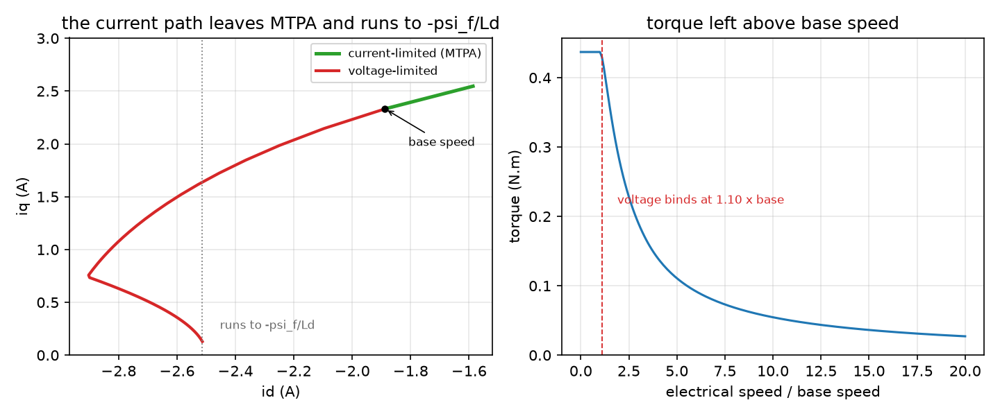

_`Above base speed`
===================

The task: the axis has to keep producing torque past the speed where the voltage
ceiling stops it. Decide whether it is worth implementing, and if it is, know what
the currents have to do.

What you need
-------------

- ``foc/core/mtpv.hpp`` -- the operating-region solver: the MTPA point, the base
  speed, and where the voltage ellipse and the current circle each bind.
- ``foc/core/field_weakening.hpp`` -- the running policy, which produces the dq
  reference at whatever speed the axis is actually at, plus its refusal semantics.
- ``foc/core/machine_map.hpp`` -- the nameplate as a function of current, for a
  machine whose inductance saturates. Optional: without it the solver uses the
  linear nameplate, which is what this page's example does.

A minimal program
-----------------

``docs/doxygen/dox/demos/slice-s4-field-weakening.cxx`` sweeps the electrical speed
through the solver and prints where each ceiling starts to bind:

.. code-block:: bash

   g++ -std=c++17 -fno-exceptions -fno-rtti -Wall -Wextra -Werror -Iinclude \
       docs/doxygen/dox/demos/slice-s4-field-weakening.cxx src/core/mtpv.cpp \
       -o /tmp/slice-s4-field-weakening

Three numbers in its output are the whole decision:

- **`lambda = Ld * i_max / psi_f`** -- above 1 the characteristic current sits
  beyond the current ceiling, so there is headroom to trade away; below 1 the
  machine cannot be weakened into a useful region at all. It is the same ratio the
  project's own domain check uses.
- **base speed** -- computed from the flux *at the MTPA point*, not from `psi_f`.
  `psi_f` alone overstates it several-fold on a salient machine, and a drive sized
  on that number finds the real ceiling when its current loop saturates.
- **the voltage binds at ...** -- the ratio where the ellipse takes over. Below it
  the answer is constant; above it the currents move every step.

Where the numbers come from
---------------------------

- **The voltage ceiling is the modulator's inscribed circle, not the rail.** Slice
  S5 shows why those differ and by how much; using the rail here makes the whole
  region look wider than it is.
- **The current ceiling is per axis in the nameplate and per vector here.** `|i|`
  is what the solver bounds.
- **The nameplate is linear unless a machine map is supplied.** Saturation moves
  the real boundary, and `machine_map` is the library's way of saying so.

How it goes wrong
-----------------

1. **Base speed taken from `psi_f`.** Too high by the amount MTPA already spends on
   the d axis, and the error is largest exactly on the salient machines this slice
   exists for.
2. **The voltage ceiling taken as the rail.** The rail is only reachable at six
   angles of the rotation; a request sized to it clips five times a revolution and
   arrives as a sixth-order torque ripple rather than a fault.
3. **Field weakening commanded without a speed.** The d current it asks for is a
   function of speed; a caller that applies the above-base answer below base speed
   gives away torque per amp for nothing.
4. **A machine outside the domain, treated as if inside.** When `lambda` is below 1
   the honest answer is "this machine cannot be weakened usefully", which is a
   sentence the page and the solver both say -- not a number pulled out of a solver
   that had to extrapolate.

Evidence
--------

Three claim rows cover this slice -- ``foc/core/field_weakening.hpp``,
``foc/core/mtpv.hpp`` and ``foc/core/machine_map.hpp`` -- and the level this page
may state is the minimum of those three. The numbers behind the boundaries are in
those rows and in ``test_mtpv.cpp``, not on this page.

Figure
------

   left: the current path, from the MTPA point at the current ceiling, past the
   base-speed marker, along the voltage ellipse towards the characteristic current.
   right: the torque that is left as the speed rises

The figure is produced by ``docs/demos/make_figures.py`` from this page's own
example; the base-speed marker and the asymptote are both **read from the run**,
not written into the plot. What it does not show is the machine: the nameplate here
is linear and the currents are the solver's answer, so a real machine's path on
this plane will bow where its inductances saturate.
