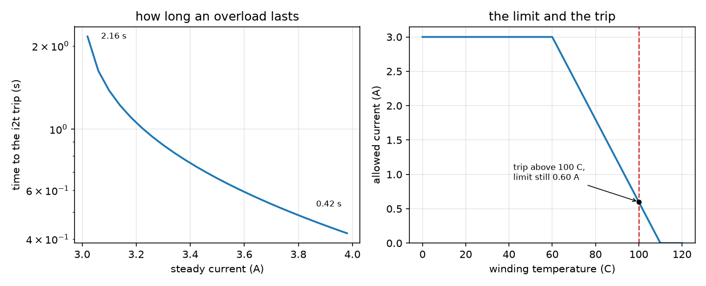

_`Health and protection`
========================

The task: decide what a drive does when something is wrong -- how long an overload
may last, what happens after it trips, and what the answers must not be confused
with.

What you need
-------------

- ``foc/core/protection.hpp`` -- the mechanism matrix (over-current, over- and
  under-voltage, temperature, i2t, stall, lost sync), the ranked fault, the latched
  mask, and the derated current limit that goes with it.
- ``foc/core/watchdog.hpp`` -- silence measurement: ``Feeding``, ``Expired``,
  ``ClockLost``, and the distinction between kicking and polling.
- ``foc/core/thermal_limit.hpp`` -- the winding's own first-order model, which is
  where the temperature the protector is fed with comes from.
- ``foc/core/brake_chopper.hpp`` -- the bus over-voltage path, with the brake
  resistor's thermal budget rather than a voltage-only decision.
- ``foc/core/auto_tune.hpp`` and ``foc/core/commissioning.hpp`` -- the parameter
  path: where the numbers a protection compares against are supposed to come from.
  The procedure that produces them is :doc:`../sop`, not a constant.

A minimal program
-----------------

``docs/doxygen/dox/demos/slice-s8-protection.cxx`` sweeps the i2t budget below the
hard trip, reads the derating curve across the trip temperature, walks the latch
through a trip and a reset, asks a watchdog past its window, and pushes the bus
into a brake chopper. The same file produces this slice's figure.

.. code-block:: bash

   g++ -std=c++17 -fno-exceptions -fno-rtti -Wall -Wextra -Werror -Iinclude \
       docs/doxygen/dox/demos/slice-s8-protection.cxx src/core/watchdog.cpp \
       -o /tmp/slice-s8-protection

Where the numbers come from
---------------------------

- **The i2t budget is not "rated current for one second".** It is
  ``i_continuous^2 * tau``, the equilibrium of the thermal model, and that
  identity is what pins the units down: a budget that is anything else either
  trips a machine running at its own nameplate or never trips at all.
- **The cooling time constant is the winding's**, not a tuning number. It is the
  same quantity ``thermal_limit.hpp`` models, and if the two disagree the budget is
  describing a different machine from the one the temperature comes from.
- **The trip and the derating endpoints come from the insulation class and the
  magnet**, and the third temperature -- where derating starts -- is where the
  drive begins to give up torque in order to stay below the other two.
- **The watchdog window** is set by the slowest legitimate silence in the system,
  not by the control period: too tight and it trips on a long branch, too loose and
  it reports a dead loop as healthy.
- **The brake resistor's budget** is its thermal mass; ``duty_max`` and the minimum
  on/off times belong to the gate driver. The chopper's job is to spend the first
  without violating the second.

How it goes wrong
-----------------

1. **The budget read as a threshold.** "It trips above rated current" is the wrong
   mental model: at the rated current the budget's equilibrium *is* the budget, so
   the time to trip is infinite, and just above it the time is finite but long. A
   supervisor that expects a threshold will size a contactor for the wrong event.
2. **Derating and tripping treated as one decision.** They are two numbers with a
   gap between them: at the trip temperature the derating curve still allows
   current. A controller that only applies the curve never trips, and one that only
   applies the trip runs at full current right up to the wire's limit.
3. **A trip that clears itself.** The output stays disabled after the current comes
   back, and that is deliberate: the reason it tripped has not been looked at.
   ``reset()`` is the caller's explicit decision, and a drive that auto-reset would
   restart into the same fault at a rate set by the fault itself.
4. **A watchdog kicked from the wrong place.** It measures silence, not progress.
   Kicking it from the same loop that must be watched -- or from an interrupt that
   keeps running while the loop is stuck -- produces a perfectly fed watchdog
   attached to a dead controller.
5. **A chopper that only watches the bus.** Holding the bus at the threshold with a
   resistor whose thermal budget is spent is a controlled way to burn the resistor.
   The budget latches the duty to zero for that reason.

Evidence
--------

Five claim rows cover this slice: ``foc/core/protection.hpp``,
``foc/core/watchdog.hpp``, ``foc/core/thermal_limit.hpp``,
``foc/core/brake_chopper.hpp`` and ``foc/core/commissioning.hpp``; the level this
page may state is the minimum of those five. The times, temperatures and budgets
this page would otherwise want to quote live in those rows and in their test files
-- the example here retypes the same configuration the protection tests use, on
purpose, so that what it demonstrates is the shipped behaviour and not a demo-only
set of limits.

Figure
------

   left: how long an overload lasts, below the hard trip -- a duration that runs
   away as the current approaches the rating; right: the continuous limit against
   temperature, with the trip threshold drawn on top of it at a temperature where
   the limit is still not zero

Both panels come from this page's example. The trip line is drawn from its own row
of data rather than from where the curve reaches zero, because those are two
different temperatures and drawing one for the other is exactly failure mode 2.
What the figure does not show is the rest of the slice: the latch, the watchdog and
the chopper are printed by the same program and are not time-series in the figure,
because a latch has one interesting instant and a plot of it would be one step.
