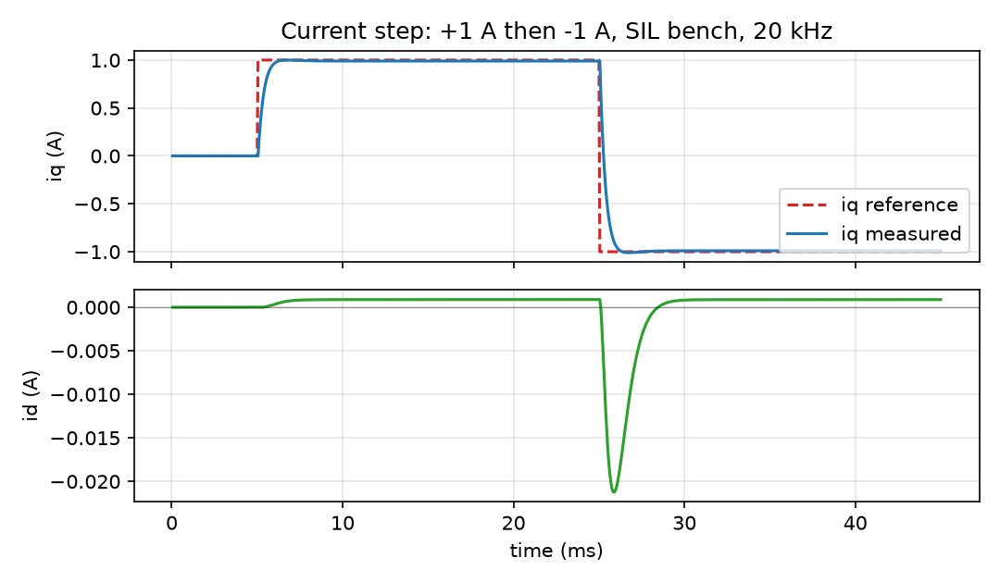

_`Torque below base speed`
===========================

The task: from a torque request, produce a dq current reference this machine can
actually deliver, and drive both current axes to it inside the voltage the
modulator has. This is the slice every other slice stands on -- the field
weakening of slice S4 answers the same question above base speed, and the
observer of slice S1 exists so that the angle this slice assumes is available
without a sensor.

What you need
-------------

- ``foc/core/reference.hpp`` -- the reference policy. ``MtpaReference`` for a
  salient machine; the default ``d = 0`` generator for a surface one.
- ``foc/core/pi.hpp`` -- one controller per axis. Two instances, not one shared:
  the integral state is per axis.
- ``foc/core/feedforward.hpp`` -- the axis cross-coupling and back-EMF terms,
  added **after** the PI so the PI keeps its own-axis job.
- ``foc/core/limits.hpp`` -- ``clamp``, and the ceiling itself. The ceiling is
  not the rail voltage: it is the modulator's linear range, which slice S5
  covers.

A minimal program
-----------------

``docs/doxygen/dox/demos/torque-reference.cxx`` is the whole of it, compiled with
the flags this repository's ``strict`` gate uses. It names one salient machine
once and asks two reference policies the same q command:

.. literalinclude:: ../../../../docs/doxygen/dox/demos/torque-reference.cxx
   :language: cpp
   :linenos:

Two rows of that output are worth reading before the rest:

- on the machine as shipped (``i_d_per_speed_a_s_per_rad`` left at zero) the
  MTPA policy answers **exactly** what the ``d = 0`` policy answers. That is not
  a bug and not a coincidence: the field's default refuses d current, because a
  d current is only safe once somebody has stated how the angle is measured.
- at the top of the sweep the q answer is slightly below the request, because
  the request does not fit ``|i| <= i_max`` and the policy walks **down the
  MTPA curve** instead of scaling both components. Scaling both would leave the
  curve and lose more torque than necessary.

Where the numbers come from
---------------------------

Every gain in the example is derived from the nameplate, not tuned: ``kp = L *
omega`` and ``ki = R * omega`` are the pole-zero cancellation, and the same
numbers come out of ``foc::current_pi_config(motor_config, bandwidth, v_bus)``,
which is what the C path, the SIL bench and a board should all call rather than
retype. The feedforward terms are built from the same nameplate through
``foc::feedforward_config(motor_config)``.

The one field that has no nameplate source is ``i_d_per_speed_a_s_per_rad``. It
is a statement about **how the angle is measured**, so it cannot be derived; the
field's own documentation carries the measured numbers for the nominal machine
and says which values are safe with and without a position sensor.

How it goes wrong
-----------------

1. **MTPA that silently equals d = 0.** Leave the d-current allowance at its
   default and everything compiles, runs, and produces the surface-machine
   answer on an interior machine. The library cannot warn: it has no way to know
   whether the zero is a decision or an omission. This is why the allowance is
   an explicit field rather than a derived one.
2. **The ceiling inside the PI.** Clamping the PI output to the linear range and
   then adding feedforward can exceed what the modulator can deliver, and the
   clamp that was supposed to stop the integral from winding up no longer
   describes the voltage being applied. Clamp the sum.
3. **Feedforward on the reference instead of the measurement.** The terms are
   ``omega * L * i`` and ``omega * psi_f``; with the reference in place of the
   measured current the term stops responding when the loop is saturated, which
   is exactly when it matters.
4. **A d-axis reference the current limit cannot honour.** The policy walks down
   the curve for this reason; a hand-written ``i_d`` that ignores the limit
   produces a pair whose magnitude exceeds ``i_max`` and the loop then chases a
   reference the hardware will never reach.

Evidence
--------

Four claim rows cover this slice, one per piece: ``foc/core/reference.hpp``,
``foc/core/limits.hpp``, ``foc/core/pi.hpp`` and ``foc/core/feedforward.hpp``.
The level this slice may state is the **minimum** of those four, and the level
itself is read from the claim table in the project ``README.md`` rather than
written here -- a number copied into a page is a second source of truth with a
shelf life.

Not claimed by this slice: the torque the loop produces. A torque figure needs a
machine model, which is the SIL bench's job and carries its own claim rows. This
page stops at the current reference and the voltage command, which is where the
library stops too.

Figure
------

   the current loop this slice builds, driven by the SIL bench: iq follows a
   1 A step in both directions, id is held near zero by the d-axis controller

The figure is produced by ``docs/demos/make_figures.py`` from the SIL bench, not
drawn by hand. It shows the loop closing; it does not show MTPA, because the
bench machine is surface-mounted and on that machine the MTPA answer is the
``d = 0`` answer. The MTPA difference is what the program on this page prints.
